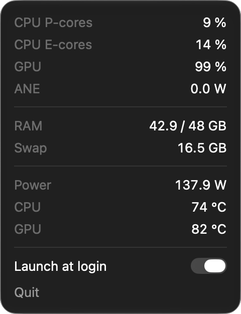

# Menutop

A small menu bar app for Apple Silicon Macs that shows what [mactop](https://github.com/context-labs/mactop) shows, without a terminal. The menu bar holds only an icon. A click opens a window with plain numbers:



| Row | Meaning |
|---|---|
| CPU P-cores, CPU E-cores | busy share of the performance and the efficiency cores |
| GPU | GPU utilization |
| ANE | Neural Engine power |
| RAM | used of total memory, counted as Activity Monitor does (app + wired + compressed) |
| Swap | swap in use |
| Power | whole system power |
| CPU, GPU | mean temperature of the CPU core and the GPU sensors |

Values refresh once per second while the window is open; when it is closed, Menutop reads nothing. It needs no sudo, helper or setup. The window has a Launch at login switch.

## Install

```sh
brew install --cask yessetmurat/tap/menutop
```

Requires an Apple Silicon Mac with macOS 27 or later.

## Where the numbers come from

| Row | Source |
|---|---|
| CPU P-cores, E-cores | `host_processor_info` tick deltas; core kind from `cluster-type` in the IORegistry device tree |
| GPU | `Device Utilization %` of the `IOAccelerator` service |
| ANE | IOReport `Energy Model` channels named `ANE*` |
| RAM, Swap | `host_statistics64`, `hw.memsize`, `vm.swapusage` |
| Power | SMC key `PSTR` |
| CPU, GPU temperature | SMC keys `Tp*`, `Te*`, `Tf*` (CPU) and `Tg*` (GPU) |

IOReport and the SMC are private, undocumented interfaces, so the app is not sandboxed and is not on the App Store, and a macOS update may break a row. A value that cannot be read shows `—`, never a guess.

On macOS 27.2 the IOReport energy channels for the Neural Engine read 0 (`mactop` shows the same), so ANE usually shows `0.0 W`.

## Building

You need Xcode 27.2 or later.

For a signed build, copy `Config/Local.example.xcconfig` to `Config/Local.xcconfig` and set your team id. Then:

```sh
xcodebuild test -project Menutop.xcodeproj -scheme Menutop -destination 'platform=macOS'
```

Without a team, sign ad hoc:

```sh
xcodebuild test -project Menutop.xcodeproj -scheme Menutop -destination 'platform=macOS' \
  CODE_SIGN_IDENTITY=- CODE_SIGN_STYLE=Manual DEVELOPMENT_TEAM=
```

## Releasing

Push a tag `v<x.y.z>`. The `Release` workflow builds with that version, signs with Developer ID, notarizes, attaches `menutop-<x.y.z>.zip` to a GitHub release and writes the cask into the tap. Its header lists the secrets it needs.

A local signed build without notarization:

```sh
MENUTOP_VERSION=0.1.0 \
  MENUTOP_RELEASE_IDENTITY="Developer ID Application: <name> (<team id>)" \
  MENUTOP_TEAM_ID=<team id> \
  scripts/package_release.sh
```
